# Relayquill

Relayquill is a self-hostable, high-integrity event admission and signed webhook delivery platform built with **Node.js 24 LTS (TypeScript)**, **PostgreSQL 18**, **NATS JetStream** (embedded via the Go `relayquill-broker` launcher), and **React 19**.

Production deployments have **zero vendor lock-in**: the entire platform runs on standard open-source PostgreSQL 18, a 3-node native-TLS NATS JetStream quorum, non-root Node worker processes, and a static Nginx console reverse proxy (`infra/compose.prod.yaml` and `infra/kubernetes/overlays/selfhosted/`). All unit, SQL contract, and end-to-end tests also run 100% offline with zero external daemons via `@electric-sql/pglite` and `InMemoryJetStreamBroker`.

---

## 1. Architecture Overview

```mermaid
flowchart LR
  Producer["Producer Application (@relayquill/producer-sdk)"]
  API["API Admission & Transactional Outbox (@relayquill/api)"]
  PG["PostgreSQL 18 Authority (rq SECURITY DEFINER)"]
  Relay["Outbox Relay Worker (@relayquill/relay)"]
  JetStream["3-Node NATS JetStream Quorum (RELAYQUILL_EVENTS_V1)"]
  Fanout["Ordered Fanout Worker (@relayquill/fanout)"]
  Sender["WDRR Rate-Governed & DNS-Pinned HTTPS Sender (@relayquill/sender)"]
  Receiver["Verified Receiver Receipt (@relayquill/receiver-sdk / rc)"]
  Coordinator["Coordinator & Two-Person Replay (@relayquill/coordinator)"]
  Console["Operator Console (@relayquill/console)"]

  Producer -->|"Bearer rq_p1 + Idempotency-Key"| API
  Console -->|"WebAuthn Passkeys + Derived CSRF"| API
  API -->|"Atomic READ COMMITTED Admission"| PG
  PG -->|"Leased Outbox Claim"| Relay
  Relay -->|"TLS + NKey PubAck (rq:outbox:gen)"| JetStream
  JetStream -->|"Pull Consumer (RELAYQUILL_FANOUT_V1)"| Fanout
  Fanout -->|"Filter AST + Strict Sequence Watermark"| PG
  PG -->|"WDRR + Microtoken Bucket + Circuit Gate"| Sender
  Sender -->|"Pinned HTTPS + 25-Field HMAC-SHA256"| Receiver
  Receiver -->|"204 Endpoint Proof / Signed v1 Receipt"| Sender
  Sender -->|"16-Shard Delta Counters & Receipt Facts"| PG
  Coordinator -->|"Reaper, Recovery & Two-Person Replay"| PG
```



### Four Strictly Separated Delivery Evidence Stages

Relayquill never collapses asynchronous event delivery into a single ambiguous status flag. Every stage is recorded and projected as an independent evidence boundary:

1. **`accepted`**: `@relayquill/api` validates the `rq_p1` producer credential and event schema, then atomically commits the immutable event record, raw payload bytes (`rq.event_payloads`), canonical RFC 8785 wire envelope (`rq.event_wire_envelopes`), business idempotency anchor, command receipt, transactional outbox root (generation `1`), and initial `event_fanout` reservation inside one PostgreSQL `READ COMMITTED` transaction before returning HTTP `201`.
2. **`published`**: `@relayquill/relay` claims due outbox roots via short leased transactions, publishes a bounded (`<= 4 KiB`) metadata notification envelope (`rq.events.<project_id>.accepted`) to NATS JetStream with deterministic `Nats-Msg-Id` (`rq:<outbox_id>:<generation>`), and records durable `PubAck` stream and sequence observations (`sync_interval: always`).
3. **`http_acknowledged`**: `@relayquill/sender` executes a DNS-pinned HTTPS `POST` outside any database transaction and observes a `2xx` HTTP status code within the monotonic request deadline. Under `http_ack_only`, a `2xx` status honestly records peer HTTP transport acceptance without claiming business completion.
4. **`consumer_processed`**: Recorded **only** when the destination endpoint opts into `receiver_local_commit_v1` and returns a bounded (`<= 4,096` bytes) JSON receipt signed under `rq.receiver-receipt.v1\0` matching the exact `project_id`, `event_id`, `consumer_event_key`, `original_facts_sha256`, `delivery_attempt_id`, and active key policy (`verified_supported`).

---

## 2. Core Architectural Guarantees

- **Atomic Idempotency & Lost-Response Resolution**:
  - Canonical RFC 8785 command fingerprinting (`relayquill.command.v1` and `relayquill.effective.v1`) binds tenant/project/channel scope, `business_key`, `content_sha256`, and option presence (`producer_event_time`, `deadline_at`).
  - First admission returns `201 Created`; byte-identical retries return `200 OK` (`matched_existing: true`); mutated payloads under the same `business_key` or `Idempotency-Key` fail closed with `409 Conflict` (`BUSINESS_IDENTITY_CONFLICT` / `IDEMPOTENCY_CONFLICT`).
  - When a client experiences a network timeout after transmission (`ACCEPTANCE_UNKNOWN`), `POST /api/v1/events/resolve` recovers the original receipt and event projection without fabricating duplicate events or advancing deadlines.
- **Lossless JSON Preservation & Bounded Evaluation (`@relayquill/event-schema`)**:
  - Strict UTF-8 validation rejects BOMs, lone UTF-16 surrogates, duplicate object keys, and trailing documents.
  - Payloads are parsed with `lossless-json` (`LosslessNumber`) and normalized with a 128-digit exact decimal engine (`[-1024, 1024]` exponent bounds)—eliminating silent IEEE-754 `Number` rounding, `Infinity` coercion, or `Date` mutation.
  - Schema evaluation (`relayquill.event-schema.v1` JSON Schema 2020-12 subset), RFC 6901 pointer filters (`relayquill.filter.v1`), strict ordering key extraction (`relayquill.ordering-extractor.v1`), and v2 derived representations (`relayquill.lossless-projection.v1`) execute inside a bounded `worker_threads` pool (`SchemaWorkerPool`) that holds timed-out worker slots until process resource exit is observed.
- **Isolated PostgreSQL `SECURITY DEFINER` Custody & Sharded Contention Control (`migrations/`)**:
  - Core delivery (`relayquill`, schemas `rq`, `rq_support`, `rq_recovery`), independent receiver (`relayquill_receiver`, schema `rc`), and provider ingress (`relayquill_provider`, schema `pi`) use distinct `NOLOGIN` owner roles (`rq_owner`, `receiver_owner`, `provider_owner`) with `PUBLIC` access revoked.
  - Runtime roles (`rq_api`, `rq_relay`, `rq_fanout`, `rq_sender`, `rq_coordinator`, `rq_reporter`, `rq_signing_issuer`, `rq_migrator`, `rq_recovery`) have **zero direct base-table DML privileges**. All mutations execute through 58 `rq_owner`-owned `SECURITY DEFINER` stored procedures (`SET search_path = pg_catalog`) that assert `session_user` and `control_epoch`, mechanically verified against `migrations/privilege-manifest.json`.
  - Hot-path transactions acquire `SELECT ... FOR SHARE` on `rq.installation_state` (`id = 1`) and `rq.projects` in deterministic lock-rank order, while delivery counter updates write to 16-shard delta tables (`rq.event_delivery_total_deltas` and `rq.project_delivery_total_deltas`) to eliminate single-row `FOR UPDATE` contention.
- **Per-Attempt Cryptographic Signing & SSRF-Hardened Pinned Egress (`@relayquill/signing`, `@relayquill/egress`)**:
  - Every delivery attempt and endpoint verification challenge is signed with HMAC-SHA256 over a length-prefixed binary preimage (`rq.webhook-signature.v1\0` + 25 ordered canonical fields, including HTTP method, normalized `external_authority`, `request_target`, scoped IDs, `delivery_generation`, `attempt_id`, `timestamp_seconds`, `consumer_event_key`, optional ordering tuple, W3C trace headers, `wire_body_sha256`, and raw wire bytes).
  - Receivers reject duplicate or coalesced security headers (`rawHeaders`), enforce a `[-300s, +30s]` freshness window, compare MACs with `crypto.timingSafeEqual`, and support 1 or 2 distinct-`kid` signatures during `bounded_dual_signature` rotation overlap.
  - Outbound delivery enforces WHATWG `https://` URL normalization (`url_v1`), evaluates a content-addressed IANA IPv4/IPv6 special-purpose CIDR deny list (`packages/egress/artifacts/iana-special-purpose.v1.json`) via `ipaddr.js`, resolves DNS in an isolated per-attempt `dns.promises.Resolver` (failing closed if **any** A or AAAA record is private, loopback, link-local, metadata, or reserved), dials a single-use socket (`agent: false`) pinned to the validated IP, and verifies `socket.remoteAddress` **before** transmitting HTTP headers or body bytes.
- **Hierarchical WDRR Dispatch, Strict Per-Key Ordering & Two-Person Replay (`@relayquill/application`)**:
  - Tenant -> Project -> Endpoint Weighted Deficit Round Robin (WDRR) scheduling with exact `1,000,000`-microtoken request cost and remainder numerator conservation, paired with per-endpoint circuit breakers (`closed` -> `open` -> `half_open` single-probe gating).
  - Subscriptions support `unordered` or `strict_per_key` delivery (`ordering_heads` / `ordering_members`), holding successor sequences on an ordering key until the predecessor completes or is resolved via a two-person reviewed skip.
  - Dead-letter replays (`replay_exact_original` or `replay_with_reviewed_representation`), ordering skips, and suppressions require a **distinct reviewer** (`proposer !== reviewer`) with operation-bound WebAuthn step-up verification, allocating a new `delivery_generation` (`append_after_current_tail`) while preserving the immutable `Relayquill-Consumer-Key`.

---

## 3. Zero Vendor Lock-In Design

Relayquill is architected so production deployments never depend on proprietary cloud databases, managed message brokers, or vendor-specific SDKs:

| Layer | Self-Hosted Production Target (`self_hosted` / `release`) | Zero-Daemon Local & CI Mode (`portable_pglite`) | Optional Remote Dev Endpoints (`.env`) |
|---|---|---|---|
| **Database** | Standard **PostgreSQL 18** (`postgres:18-bookworm` or native OS install) via `pg` with `standard_tls` (`sslmode=verify-full`) and `SCRAM-SHA-256` | In-memory **`@electric-sql/pglite`** (`0.5.16`) with `btree_gist` loaded (`config/portable.*.json`) | Optional `config/hosted.neon.*.json` or `config/hosted.supabase.*.json` over standard `pg` |
| **Message Broker** | 3-node self-hosted **NATS JetStream quorum** via `tools/broker-launcher` (`relayquill-broker`, Go `1.27.1`) with client TLS, cluster route mTLS, and Ed25519 NKey ACLs | Deterministic **`InMemoryJetStreamBroker`** implementing stream limits, `DiscardNew`, 120s dedup window, `AckWait`, and `MaxDeliver` | Optional `config/hosted.synadia.*.json` over standard `@nats-io/transport-node` |
| **Secret Custody** | File-mounted secrets (`/run/secrets/...`, `mode: "mounted_file"`) with non-serializing in-memory `SecretHandle` | Local protected IPC fixture secret provider (`Win32` Named Pipe DACL / POSIX `0700`/`0600` UDS) | `.env` environment references (`env_file` / `env_reference`) |
| **Runtime & UI** | Non-root Node 24 containers (`uid 10001`, read-only rootfs) + non-root Nginx console reverse proxy (`uid 101`) | Direct Node `24.16.0` worker processes + Vite / Playwright headless Chromium | Local Node `24.16.0` processes + Vite dev server (`http://localhost:5205`) |

---

## 4. Monorepo Workspace Map

```text
relayquill/
├── apps/
│   ├── api/                 # @relayquill/api — Fastify admission, control-plane & SSE watch server (:8005)
│   ├── relay/               # @relayquill/relay — Transactional outbox -> JetStream publisher worker
│   ├── fanout/              # @relayquill/fanout — JetStream pull consumer -> ordered subscription matcher
│   ├── sender/              # @relayquill/sender — WDRR rate-governed, DNS-pinned HTTPS webhook sender
│   ├── coordinator/         # @relayquill/coordinator — Reaper, eligibility promoter, recovery & retention worker
│   ├── admin/               # @relayquill/admin — Operator CLI (db migrate, broker ensure, provider, diagnostics, recovery)
│   └── console/             # @relayquill/console — React 19 + Vite WCAG AA operator console (localhost:5205)
├── packages/
│   ├── domain/              # @relayquill/domain — Pure zero-Node-builtin domain types, UUID brands & state machines
│   ├── contracts/           # @relayquill/contracts — HTTP envelopes, capabilities, cursors, SSE, canonical commands & wire codecs
│   ├── runtime/             # @relayquill/runtime — Role config loader, Win32/POSIX IPC, SecretHandle, deadlines & OpenTelemetry
│   ├── event-schema/        # @relayquill/event-schema — Lossless JSON parser, 128-digit decimals, Schema/Filter/Projection worker pool
│   ├── egress/              # @relayquill/egress — WHATWG HTTPS URL normalizer, IANA CIDR policy, isolated DNS & pinned TLS connector
│   ├── signing/             # @relayquill/signing — 25-field rq.webhook-signature.v1 HMAC, key rotation, 204 proof & v1 receipts
│   ├── broker/              # @relayquill/broker — NATS JetStream TLS/NKey adapter, stream contract & InMemoryJetStreamBroker
│   ├── auth/                # @relayquill/auth — WebAuthn passkeys, sessions, derived CSRF, step-up proofs, rq_p1 credentials & RBAC
│   ├── application/         # @relayquill/application — Port-isolated application use cases, WDRR scheduler & 4-stage evidence
│   ├── postgres/            # @relayquill/postgres — Standard pg pool + PGlite adapter, ranked transactions & rq repositories
│   ├── producer-sdk/        # @relayquill/producer-sdk — Portable zero-Node-builtin ESM SDK for event preparation, admission & SSE watch
│   └── receiver-sdk/        # @relayquill/receiver-sdk — Standalone ESM SDK for webhook verification, 204 proofs, receipts & idempotency
├── examples/
│   ├── receiver/            # @relayquill/example-receiver — Independent customer receiver authority (rc schema, :19095)
│   ├── provider-ingress/    # @relayquill/example-provider-ingress — Stripe/Paystack verifier & forwarder (pi schema, :19096)
│   └── producer/            # @relayquill/example-producer — Reference producer client
├── migrations/              # PostgreSQL 18 & PGlite SQL migrations (0001..0009) + privilege-manifest.json
├── contracts/               # Draft 2020-12 JSON Schemas & canonical test vectors (webhook-v1, broker-v1, canonical-command-v1, compatibility)
├── config/                  # Non-secret JSON role templates (development, portable, selfhosted, release, hosted, diagnostics, recovery, load) & schemas
├── infra/
│   ├── compose.dev.yaml     # Loopback dev backing stack (postgres:18-bookworm :55005, nats:2-alpine :14225, otel :14317/:14318)
│   ├── compose.prod.yaml    # 100% self-hosted production Compose stack (PG18 TLS, 3-node Go broker quorum, non-root workers & Nginx console)
│   ├── images/              # Hardened multi-stage Dockerfiles (application.Dockerfile, console.Dockerfile, broker.Dockerfile)
│   ├── broker/              # NATS development.conf & 3-node self-hosted public-topology.json
│   ├── postgres/            # Self-hosted PostgreSQL 18 role bootstrap script & hostssl pg_hba.conf
│   ├── scripts/             # Self-hosted PKI certificate generator (generate-selfhosted-certs.sh)
│   ├── kubernetes/          # Base manifests, receiver/ingress workloads, jobs, overlays/selfhosted & optional overlays/eks
│   └── aws/                 # Optional AWS Terraform modules (zero secrets in state)
├── tools/
│   ├── broker-launcher/     # Go 1.27.1 embedded NATS JetStream launcher (relayquill-broker) with TLS, route mTLS & NKey ACLs
│   ├── verify-import-boundaries.mjs
│   ├── check-hygiene.mjs
│   ├── build-workspaces.mjs
│   ├── typecheck-workspaces.mjs
│   ├── build-sdk.mjs & pack-sdks.mjs
│   └── {release,cluster,recovery,load,operations}/
├── tests/
│   ├── tooling/             # Hygiene, import boundaries, config schema & operational CLI unit tests
│   ├── contracts/           # PGlite SQL migration, pg_proc vs privilege-manifest.json & repository contract tests
│   └── e2e/                 # Multi-tier Playwright + PGlite E2E runner (run.mjs) and harnesses
└── docs/                    # Architecture, local dev setup, self-hosted production guide & operational runbooks
```

---

## 5. Quickstart

### 5.1 Install & Configure Environment

Requires **Node.js `>= 24.16.0 < 27`** (`.node-version` pins `24.16.0`), **npm `11.13.0`**, and **Go `1.27.1`** (for `tools/broker-launcher`).

```bash
npm install
cp .env.example .env
```

### 5.2 Zero-Daemon Verification & E2E Suite (No Docker Required)

Run all static gates, unit suites, PGlite SQL migration & privilege-manifest contract checks, standalone SDK tarball verification, and the Playwright + PGlite E2E suite completely offline:

```bash
npm run hygiene
npm run boundaries
npm run typecheck
npm run lint
npm run build
npm test
node --test tests/contracts
node tools/pack-sdks.mjs
node tests/e2e/run.mjs --suite harness
node tests/e2e/run.mjs
```

To run the embedded Go broker launcher checks:

```bash
cd tools/broker-launcher
go vet ./...
go test -race -count=1 ./...
```

### 5.3 Self-Hosted Production Deployment (`infra/compose.prod.yaml`)

1. Generate self-hosted TLS certificates (`postgres-ca.pem`, `broker-ca.pem`, `broker-cluster-ca.pem`), Ed25519 NKey pairs (`relay`, `fanout`, `admin`), and scoped database role password files under `./infra/secrets/` following [docs/self-hosted-production.md](./docs/self-hosted-production.md):
   ```bash
   ./infra/scripts/generate-selfhosted-certs.sh ./infra/secrets/certs
   ```
2. Validate, build, and start the self-hosted production Docker Compose stack:
   ```bash
   docker compose -f infra/compose.prod.yaml config --quiet
   docker compose -f infra/compose.prod.yaml build
   docker compose -f infra/compose.prod.yaml up -d postgres broker-1 broker-2 broker-3
   docker compose -f infra/compose.prod.yaml --profile ops run --rm migrate-db
   docker compose -f infra/compose.prod.yaml --profile ops run --rm ensure-broker
   docker compose -f infra/compose.prod.yaml up -d api relay fanout sender coordinator console
   ```

### 5.4 Self-Hosted Kubernetes Overlay (`infra/kubernetes/overlays/selfhosted`)

Render, validate, and apply the vendor-neutral Kubernetes overlay (self-hosted PostgreSQL 18 StatefulSet, 3-node `relayquill-broker` StatefulSet, default-deny `NetworkPolicy`, `PodDisruptionBudget`, and application deployments) on any conformant Kubernetes cluster:

```bash
kubectl kustomize infra/kubernetes/overlays/selfhosted > /tmp/relayquill-selfhosted.yaml
node tools/cluster/validate-rendered.mjs
kubectl apply -f infra/kubernetes/base/namespaces.yaml
kubectl apply -f infra/kubernetes/overlays/selfhosted/namespace-data.yaml
# Provision out-of-band TLS/NKey/password Secrets in relayquill-data and relayquill-app, then apply:
kubectl apply -k infra/kubernetes/overlays/selfhosted
kubectl apply -f infra/kubernetes/jobs/migrate.yaml
```

See [docs/self-hosted-production.md](./docs/self-hosted-production.md) for full certificate, NKey, and rolling-upgrade procedures, and [docs/dev-setup.md](./docs/dev-setup.md) for containerized local development (`infra/compose.dev.yaml`) and optional `.env` remote dev endpoints.

---

## 6. Public SDK Usage Examples

### 6.1 Producer SDK (`@relayquill/producer-sdk`)

`@relayquill/producer-sdk` is a zero-Node-builtin ESM package using standard Web Crypto (`crypto.subtle`), `fetch`, `AbortSignal`, and `TextEncoder`, aligned with `@relayquill/contracts` (`AdmitEventRequestDto`, `AdmitEventResultDto`, `ResolveEventRequestDto`, `ResolveEventResultDto`, and `ParsedSseFrame`).

```typescript
import {
  ProducerAcceptanceUnknownError,
  ProducerConflictError,
  createProducerClient,
  prepareEvent
} from "@relayquill/producer-sdk";

const producer = createProducerClient({
  baseUrl: "http://127.0.0.1:8005",
  projectId: "00000000-0000-4000-8000-000000000001",
  getCredential: () => process.env.RELAYQUILL_PRODUCER_CREDENTIAL!
});

// 1. Freeze payload bytes, canonical SHA-256 digest, and business_key before network I/O
const prepared = await prepareEvent({
  expectedPublicationChannelId: "00000000-0000-4000-8000-000000000010",
  eventTypeId: "00000000-0000-4000-8000-000000000020",
  eventSchemaVersion: 1,
  businessKey: "invoice.paid:inv_2026_0001",
  content: new TextEncoder().encode(
    JSON.stringify({
      invoice_id: "inv_2026_0001",
      amount_minor: "9007199254740993",
      currency: "USD"
    })
  ),
  producerEventTime: "2026-11-18T08:00:00.000000Z"
});

try {
  // 2. Submit idempotently (201 Created on initial admission, 200 OK on byte-identical replay)
  const submitted = await producer.submitEvent(prepared);
  console.log({
    status: submitted.status,
    outcome: submitted.outcome,
    receiptId: submitted.data.receipt.id,
    eventId: submitted.data.event.event_id,
    sequence: submitted.data.event.project_event_sequence,
    contentSha256: submitted.data.event.original_content_sha256
  });

  // 3. Watch live SSE progress frames (<= 8 KiB bounded frames with Last-Event-ID cursor tracking)
  const abortController = new AbortController();
  const stream = producer.watchEvents({
    eventId: submitted.data.event.event_id,
    signal: abortController.signal
  });

  for await (const frame of stream) {
    if (frame.frame_type === "snapshot" || frame.frame_type === "event") {
      console.log("Watch cursor:", stream.getLastHandledCursor(), "Frame:", frame.frame_type);
      abortController.abort();
    }
  }
} catch (err) {
  if (err instanceof ProducerAcceptanceUnknownError) {
    // 4. Deterministically resolve lost admission responses without inventing a new idempotency key
    const resolved = await producer.resolvePreparedEvent(prepared);
    if (resolved.found) {
      console.log("Recovered committed event:", resolved.data.event.event_id);
    }
  } else if (err instanceof ProducerConflictError) {
    console.error("Payload differed from previously admitted business_key:", err.code);
  } else {
    throw err;
  }
}
```

### 6.2 Receiver SDK (`@relayquill/receiver-sdk`)

`@relayquill/receiver-sdk` enforces single-occurrence raw HTTP header checks (`rawHeaders`), `[-300s, +30s]` timestamp freshness, `Relayquill-Body-SHA256` verification, 25-field `rq.webhook-signature.v1` constant-time HMAC verification, `204 No Content` endpoint ownership proof responses (`rq.endpoint-proof.v1`), idempotent/strict-ordered delivery execution, and signed `receiver_local_commit_v1` receipts (`ReceiverLocalCommitReceiptV1`).

```typescript
import http from "node:http";
import {
  InMemoryReceiverInboxAdapter,
  InMemoryReceiverKeyProvider,
  createReceiverKeyHandle,
  createSignedDeliveryReceipt,
  executeIdempotentDelivery,
  handleEndpointProofChallenge,
  readBoundedRawWebhookRequest,
  verifyWebhookRequest
} from "@relayquill/receiver-sdk";

const keyHandle = createReceiverKeyHandle(
  Buffer.from(process.env.WEBHOOK_SIGNING_KEY_HEX!, "hex")
);

const keyProvider = new InMemoryReceiverKeyProvider([
  {
    metadata: {
      projectId: "00000000-0000-4000-8000-000000000001",
      endpointId: "00000000-0000-4000-8000-000000000030",
      keyId: "k1_2026_11",
      state: "active"
    },
    handle: keyHandle
  }
]);

const inboxAdapter = new InMemoryReceiverInboxAdapter();

const server = http.createServer(async (req, res) => {
  const rawReq = await readBoundedRawWebhookRequest(req);

  const verification = await verifyWebhookRequest({
    method: rawReq.method,
    rawHeaders: rawReq.rawHeaders,
    rawBodyBytes: rawReq.rawBodyBytes,
    expectedTarget: {
      externalAuthority: "hooks.customer.example:443",
      requestTarget: "/webhooks/relayquill"
    },
    expectedContext: {
      projectId: "00000000-0000-4000-8000-000000000001",
      endpointId: "00000000-0000-4000-8000-000000000030"
    },
    keyProvider
  });

  if (verification.kind === "rejected") {
    res.writeHead(verification.httpStatus, { "content-type": "application/json" });
    res.end(JSON.stringify({ error: verification.safeReason }));
    return;
  }

  // 1. Endpoint onboarding & rotation proof challenge (returns 204 + Relayquill-Endpoint-Proof)
  if (verification.kind === "verified_endpoint_verification") {
    const proof = await handleEndpointProofChallenge({
      verified: verification,
      keyProvider
    });
    res.writeHead(proof.statusCode, proof.headers);
    res.end();
    return;
  }

  // 2. Verified event delivery: enforce idempotent inbox dedup & contiguous ordering
  const execution = await executeIdempotentDelivery({
    verified: verification,
    orderingMode: "strict_per_key",
    adapter: inboxAdapter,
    onBusinessMutation: async ({ envelope, originalContentBytes }) => {
      const payloadText = new TextDecoder().decode(originalContentBytes);
      console.log("Applying business mutation for event:", envelope.event_id, payloadText);
    }
  });

  if (execution.outcome === "gap" || execution.outcome === "conflict") {
    res.writeHead(409, { "content-type": "application/json" });
    res.end(JSON.stringify({ outcome: execution.outcome }));
    return;
  }

  // 3. Return a signed receiver_local_commit_v1 receipt (<= 4,096 bytes)
  const signedReceipt = await createSignedDeliveryReceipt({
    verified: verification,
    receiptId: "00000000-0000-4000-8000-000000000099",
    committedAt: "2026-11-18T08:00:01.000000Z",
    keyProvider
  });

  res.writeHead(signedReceipt.statusCode, signedReceipt.headers);
  res.end(signedReceipt.bodyBytes);
});

server.listen(19095, "127.0.0.1");
```

---

## 7. Documentation & Operational Runbooks

- [Architecture Specification](./docs/architecture.md) — Authority boundaries (`rq`, `rc`, `pi`, JetStream), 4 evidence stages, lock ranking & 16-shard delta counters, dual-platform IPC, egress pinning, and signing.
- [Local Development Setup](./docs/dev-setup.md) — Zero-daemon `portable_pglite` mode, containerized `infra/compose.dev.yaml`, optional `.env` remote dev endpoints, and Stripe/Paystack test-mode callbacks.
- [Self-Hosted Production Guide](./docs/self-hosted-production.md) — Certificate and Ed25519 NKey generation, `infra/compose.prod.yaml`, and `infra/kubernetes/overlays/selfhosted/`.
- [Incident Response & Causal Troubleshooting Runbook](./docs/runbooks/incident-response.md) — Boundary-by-boundary diagnosis using read-only `rq_reporter` diagnostics.
- [Isolated Restore & Receiver Reconciliation Runbook](./docs/runbooks/isolated-restore.md) — Old-writer containment, isolated PostgreSQL 18 restore, `control_epoch` rotation, and two-person `rq_recovery` reconciliation against independent `rc` and `pi` authorities.
- [Security Policy](./SECURITY.md) & [Contributing Guide](./CONTRIBUTING.md).

---

## 8. License

Licensed under the [Apache License, Version 2.0](./LICENSE).
